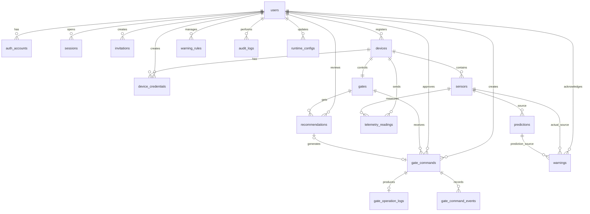

# Database Relations & ERD — Main Backend

## 1. ERD Konseptual

Diagram ini bersifat konseptual. Relasi dua FK user pada gate_commands memiliki nama relasi terpisah pada Prisma.

## 2. Relasi Detail

| Parent | Child | Kardinalitas | Aturan |
|---|---|---|---|
| users | auth_accounts | 1:N | Satu user dapat memiliki LOCAL dan/atau GOOGLE |
| users | sessions | 1:N | Multi-session |
| users | invitations | 1:N | created_by |
| users | devices | 1:N | created_by |
| users | device_credentials | 1:N | created_by |
| devices | device_credentials | 1:N | Riwayat credential |
| devices | sensors | 1:N | Sensor terpasang pada device |
| devices | telemetry_readings | 1:N | Device pengirim |
| sensors | telemetry_readings | 1:N | Sensor sumber |
| devices | gates | 1:1 | device_id pada gates UNIQUE |
| gates | gate_commands | 1:N | Command untuk gate |
| users | gate_commands | 1:N | Dua relasi: created_by dan approved_by |
| gate_commands | gate_operation_logs | 1:0..1 | command_id UNIQUE |
| gate_commands | gate_command_events | 1:N | Riwayat event |
| sensors | predictions | 1:N | Sumber prediksi |
| sensors | warnings | 1:N | Hanya warning ACTUAL |
| predictions | warnings | 1:N | Hanya warning PREDICTION |
| users | warnings | 1:N | acknowledged_by |
| users | warning_rules | 1:N | created_by dan updated_by |
| gates | recommendations | 1:N | Rekomendasi untuk gate |
| users | recommendations | 1:N | reviewed_by |
| recommendations | gate_commands | 1:0..1 | recommendation_id nullable + UNIQUE |
| users | audit_logs | 1:N | user_id nullable |
| users | runtime_configs | 1:N | updated_by nullable |

## 3. Relasi Khusus dan Integritas

### 3.1 Telemetry harus cocok dengan Device dan Sensor

`sensors` harus memiliki UNIQUE (`id`, `device_id`). `telemetry_readings` memiliki composite FK (`sensor_id`, `device_id`) yang merujuk ke (`sensors.id`, `sensors.device_id`).

Dengan demikian, backend dan database sama-sama mencegah device mengirim data menggunakan sensor milik device lain.

### 3.2 Device dan Gate 1:1

`gates.device_id` harus UNIQUE dan FK ke `devices.id`. Jika perangkat diganti, relasi gate dapat diperbarui melalui prosedur yang menjaga histori command dan operation log.

### 3.3 Recommendation dan Gate Command

`gate_commands.recommendation_id` nullable dan UNIQUE:
- Command MANUAL: NULL.
- Command AI_RECOMMENDATION: mengacu pada satu recommendation.
- Satu recommendation maksimal menghasilkan satu command.

Periksa circular relation Prisma karena `gate_commands` merujuk `recommendations`, sedangkan recommendation memiliki relasi konseptual ke command melalui FK tersebut. Secara fisik hanya FK dari gate_commands yang diperlukan.

### 3.4 Warning harus punya satu sumber

CHECK constraint:
- ACTUAL: sensor_id NOT NULL dan prediction_id NULL.
- PREDICTION: prediction_id NOT NULL dan sensor_id NULL.

### 3.5 User historis

Relasi histori yang wajib dipertahankan menggunakan RESTRICT atau SET NULL sesuai makna:
- Jangan menghapus user yang masih direferensikan.
- Untuk actor historis yang boleh hilang, gunakan SET NULL.
- Kebijakan final harus konsisten per relasi dan tidak boleh menyebabkan histori operasi terhapus.

## 4. Rekomendasi On Delete

- Master data yang punya histori: RESTRICT dan deactivate.
- `audit_logs.user_id`: SET NULL agar log tetap ada.
- `warnings.acknowledged_by`: SET NULL agar warning tetap ada.
- `recommendations.reviewed_by`: SET NULL agar recommendation tetap ada.
- `gate_commands.created_by`: RESTRICT atau kebijakan arsip actor; jangan cascade.
- `gate_commands.approved_by`: SET NULL jika akun dihapus secara administratif, meski user normalnya tidak dihapus.
- `gate_command_events.command_id`: RESTRICT.
- `gate_operation_logs.command_id`: RESTRICT.
- Telemetry ke sensor/device: RESTRICT.

Hard-delete pada tabel histori tidak boleh dilakukan oleh endpoint operasional.
